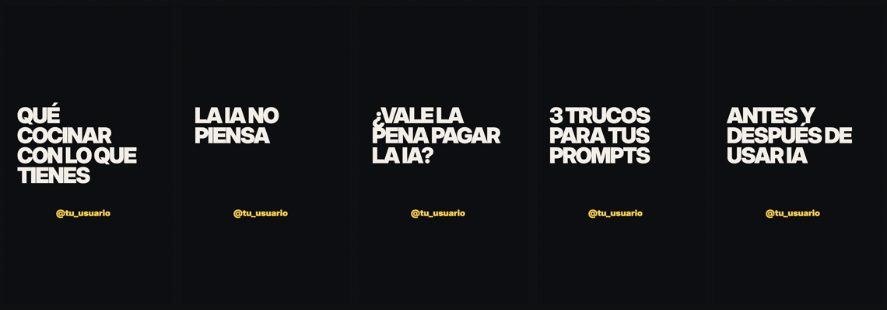
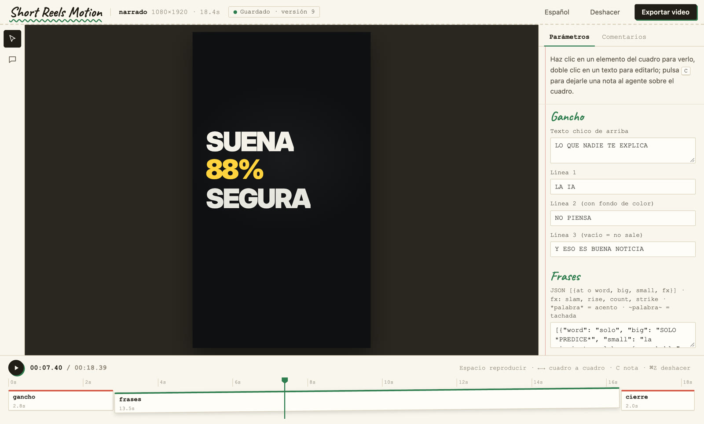

<div align="center">

# Short Reels Motion

**Tu agente hace el short; tú señalas el cuadro para cambiarlo.**

Shorts, Reels y TikToks como código: video vertical, narración sincronizada palabra por palabra,
las zonas seguras de cada app y un editor en el navegador donde comentas sobre el cuadro.



<sub>Pantalla del celular · Tipografía con voz · Cara a cámara · Lista · Antes y después — todo hecho como código, con música compuesta por el motor</sub>

[](LICENSE)
[](https://agentskills.io)

[Qué es](#qué-es) · [Instalar](#instalar) · [Cómo se usa](#cómo-se-usa) · [El studio](#el-studio) · [Tu kit](#tu-kit) · [Voz](#voz) · [Créditos](#créditos-y-licencia)

</div>

> **Estado:** en desarrollo. Faltan la ingesta de grabaciones del celular, la exportación por plataforma,
> generar la voz de ElevenLabs desde `srm` y los videos demo propios. Ver [Hoja de ruta](#hoja-de-ruta).

---

## Qué es

Le dices a tu agente de código (Claude Code, Codex o cualquiera con skills) «hazme un reel de 35 segundos sobre cómo
usar la IA para resumir correos». Escribe el video como una página (HTML + GSAP), le pone tu voz o una voz generada,
lo sincroniza palabra por palabra y abre un editor en tu navegador. Haces clic donde algo no te gusta, escribes qué
quieres y el agente cambia exactamente eso. Al final exporta un MP4 listo para subir.

Lo que lo hace distinto para videos cortos:

| | |
|---|---|
| **Vertical primero** | Cuadros de 1080×1920; el texto se acomoda lejos de los botones de TikTok, Reels y Shorts |
| **Voz en español** | Tu grabación, una voz local gratis o ElevenLabs; los movimientos caen en la palabra exacta |
| **Volumen de feed** | La mezcla de voz y música sale a −14 LUFS, donde normalizan las apps |
| **Editor en tu idioma** | El studio, las plantillas y los mensajes del motor en español (también inglés y chino) |
| **Tu marca, no la nuestra** | Sin marca de agua: el video termina con tu @usuario |

## Instalar

Lo más fácil: pídeselo a tu agente (Claude Code o Codex):

> Instala Short Reels Motion: https://github.com/itsmillanessa/short-reels-motion

O corre el instalador tú mismo:

```sh
# macOS y Linux
curl -fsSL https://raw.githubusercontent.com/itsmillanessa/short-reels-motion/main/install.sh | bash
```

```powershell
# Windows (PowerShell)
irm https://raw.githubusercontent.com/itsmillanessa/short-reels-motion/main/install.ps1 | iex
```

El instalador revisa lo que hace falta (git, Node 22 o más nuevo, FFmpeg y un navegador Chrome, Edge o Brave), descarga
Short Reels Motion en `~/short-reels-motion`, instala el comando `srm` y registra el skill «director de shorts» para Claude
Code (`~/.claude/skills`) y Codex (`~/.codex/skills`). Si falta algo del sistema, solo te dice qué y cómo instalarlo; con
`--yes` (Windows: `-Yes`) lo instala él (Homebrew en macOS, apt en Linux, winget en Windows). `--whisper` agrega
whisper-cpp para usar tu propia grabación como voz. Para actualizar, vuelve a correrlo. `srm doctor` revisa todo.

**En Windows** el one-liner no recibe opciones; pásalas con variables antes de correrlo, o con el bloque:

```powershell
$env:SRM_YES = 1; $env:SRM_KOKORO = 1; irm https://raw.githubusercontent.com/itsmillanessa/short-reels-motion/main/install.ps1 | iex
& ([scriptblock]::Create((irm https://raw.githubusercontent.com/itsmillanessa/short-reels-motion/main/install.ps1))) -Yes -Kokoro -Whisper
```

`-Yes` instala con winget lo que falte, `-Kokoro` la voz gratis Kokoro y `-Whisper` whisper (también después:
`srm voice --setup` y `srm voice --setup whisper`). Si algo falla, el instalador dice qué y tu ventana sigue abierta. En
un Windows nuevo, PowerShell no deja correr scripts: `srm` funciona igual en cmd y Git Bash, y con `-Yes` el instalador
cambia la política de tu usuario a `RemoteSigned` (o hazlo tú: `Set-ExecutionPolicy -Scope CurrentUser RemoteSigned`).

El comando es `srm` (también `short-reels-motion`). Habla en español si tu kit, `SRM_LANG` o tu sistema están en español.

## Cómo se usa

```sh
srm new mi-reel --template short-pantalla   # vertical desde el inicio (srm templates lista las 17)
srm voice mi-reel --audio voz.m4a      # tu grabación, alineada palabra por palabra
srm sound mi-reel                      # música y efectos, bajo la voz
srm studio mi-reel                     # editor en el navegador: C para comentar sobre el cuadro
srm check mi-reel                      # texto cortado, tapado o bajo los botones de las apps
srm render mi-reel                     # MP4 listo para subir
```

Lo normal es no escribir estos comandos: se los pides a tu agente y él los corre.

## El studio



- **Espacio** reproduce, las flechas avanzan cuadro por cuadro.
- A la derecha, todo lo editable por grupos (gancho, frases, cierre, colores…): cambias un texto o un color y el video se
  actualiza al momento. Doble clic sobre un texto del video para editarlo ahí mismo.
- **C** y un clic en el cuadro: le dejas una nota a tu agente justo en ese punto y él hace ese cambio.
- Cada versión se guarda; **Deshacer** siempre funciona. **Exportar video** saca el MP4.

## Tu kit

Tu marca se dice una vez y cada video nuevo arranca con ella:

```sh
srm kit set handle=@tu_usuario accent=#E4007C ground=#0E0E10 ink=#F3EFE6 cta="SÍGUEME PARA MÁS" lang=es-MX speed=1.2
srm kit set character.hair=curly character.accessory=glasses   # tu narrador dibujado (plantilla storytime)
srm kit                                                        # ver tu kit
srm kit import mi-kit.json                                     # o traerlo de un archivo
```

`srm new` aplica a cada proyecto nuevo las variables que la plantilla tenga con esos nombres (`--no-kit` para no
hacerlo); `srm voice` usa tu voz y velocidad si no le dices otra. Lo normal es que tu agente te pregunte esto la primera
vez y lo guarde él.

## Voz

| Opción | Cómo | Costo |
|---|---|---|
| Tu propia grabación | `srm voice <dir> --audio voz.m4a` (whisper saca los tiempos de cada palabra; se instala una vez: `srm voice --setup whisper` en Windows, `brew install whisper-cpp` en Mac) | Gratis |
| Voz local Kokoro | `srm voice <dir> --text guion.txt` (voz `ef_dora` para guiones en español; se instala una vez con `srm voice --setup`, ~400 MB) | Gratis |
| Voz del sistema | Mac: `--voice say:Paulina`. Windows: `--voice win` (Sabina, es-MX, ya viene en Windows en español). Sin Kokoro instalado, `srm voice` usa esta sola | Gratis |
| ElevenLabs | genera la toma con sus tiempos (`with-timestamps`) y pásala: `srm voice <dir> --audio toma.mp3 --words tiempos.json` (cada palabra exacta, sin whisper; `--speed 1.2` la acelera) | De pago |

## Zonas seguras

En el teléfono, TikTok, Reels y Shorts dibujan su interfaz encima del video: pestañas arriba, botones a la derecha,
tu @usuario, el texto y la canción abajo. Short Reels Motion lo da por hecho: las plantillas verticales ponen el texto
en el área libre del centro, y `srm check` avisa si un texto queda debajo de esa interfaz. El studio muestra el video
completo, sin guías encima. `data-platforms="tiktok,reels"` en la raíz del video elige las apps;
`data-layout-allow-safe-zone` exime un elemento. Las medidas están en `cli/lib/safezones.js`.

## Hoja de ruta

- [x] Cue por palabra exacta, mezcla a −14 LUFS, voz en español por defecto
- [x] Zonas seguras en `check` y en el diseño de las plantillas
- [x] Studio que se recupera solo al reiniciarse; textos del motor en español
- [x] Plantillas y fuentes en español; firma apagada por defecto
- [x] Personaje propio y configurable (piel, pelo, ropa, accesorio) en la plantilla `storytime`
- [ ] Videos demo propios (`srm demo` todavía abre los del motor original)
- [x] Plantilla vertical `short-pantalla`: grabación del celular con gancho, textos clave, toques, zoom y cierre
- [x] 4 plantillas verticales más: `short-tipografia`, `short-cara`, `short-lista`, `short-antes-despues`
- [x] Librería de movimientos para shorts (`runtime/srm-motion.js` → `vendor/srm.js`)
- [x] La narración reconoce palabras con acento («Sígueme», «más») como anclas
- [x] Kit del creador (`srm kit`): @usuario, colores, cierre, idioma, plataformas, voz, velocidad y personaje
- [ ] Ingesta de grabaciones del celular; portada y exportación por plataforma
- [x] Tiempos de ElevenLabs (`srm voice --words`): palabras exactas sin whisper, con la toma acelerada o sin acelerar
- [x] Bocas que siguen la voz: `srm voice` mide su volumen (`OM.env`, `TOON.mouth`) y la boca cierra en cada pausa
- [x] `srm qa` distingue las pausas a propósito (`OM.hold`); `data-om-illustrative` para recreaciones sin producto
- [ ] Generar la voz de ElevenLabs desde `srm` con tu key
- [x] Kokoro en un paso (`srm voice --setup`); whisper en Windows (`srm voice --setup whisper`); voces de Windows (`--voice win`)
- [x] Skill «director de shorts» en español (`skills/short-reels-motion/SKILL.md` + `references/shorts.md`)
- [x] Instalador de una línea para Mac/Linux (`install.sh`) y Windows (`install.ps1`, probado en Windows 11 con PowerShell 5.1)
- [x] Windows de primera: `srm doctor` sin abrir Chrome, sin carpetas temporales sueltas, saltos de línea LF, `bin\srm.cmd` para el skill, CI en Windows, macOS y Linux

## Créditos y licencia

**Short Reels Motion** © 2026 [Alexis Millán](https://github.com/itsmillanessa), MIT.

Está construido sobre el motor de [**huashu-motion**](https://github.com/alchaincyf/huashu-motion) de
[Huashu (花叔)](https://github.com/alchaincyf), MIT. Su aviso de copyright se conserva en [`LICENSE`](LICENSE) y
[`NOTICE.md`](NOTICE.md) dice qué viene de ahí y qué cambia aquí. Las piezas de terceros conservan sus licencias
([`THIRD_PARTY.md`](THIRD_PARTY.md)): GSAP, Three.js y las fuentes (SIL OFL 1.1). Los README originales están en
[`docs/upstream/`](docs/upstream/).
